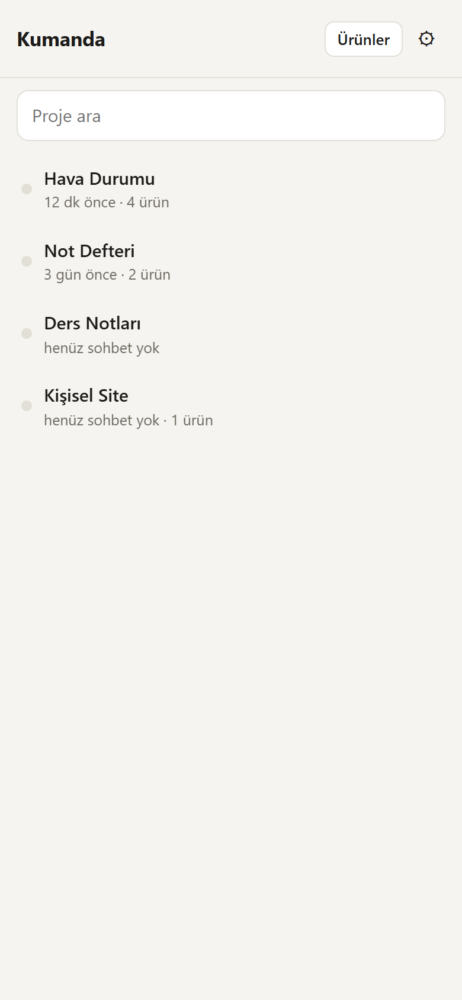
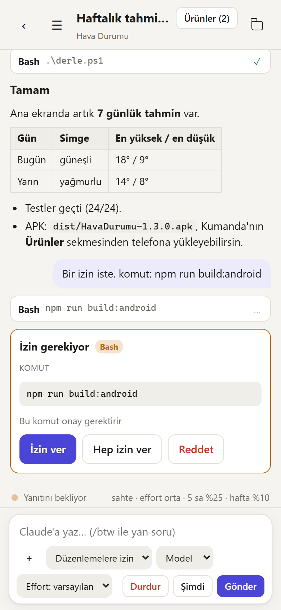
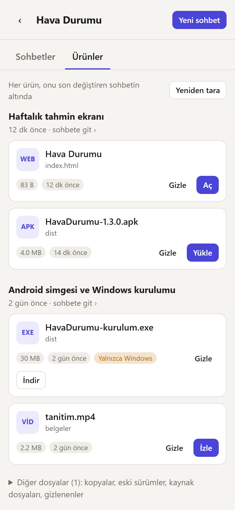
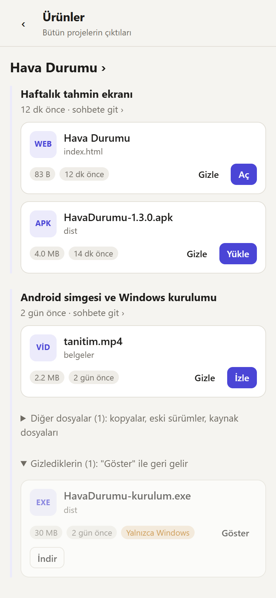
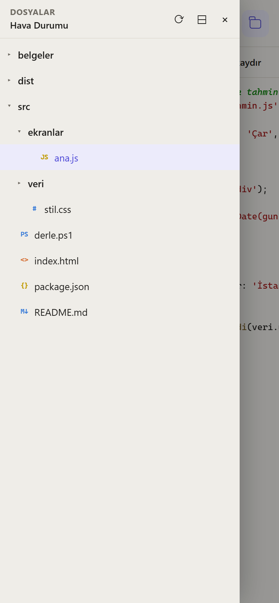
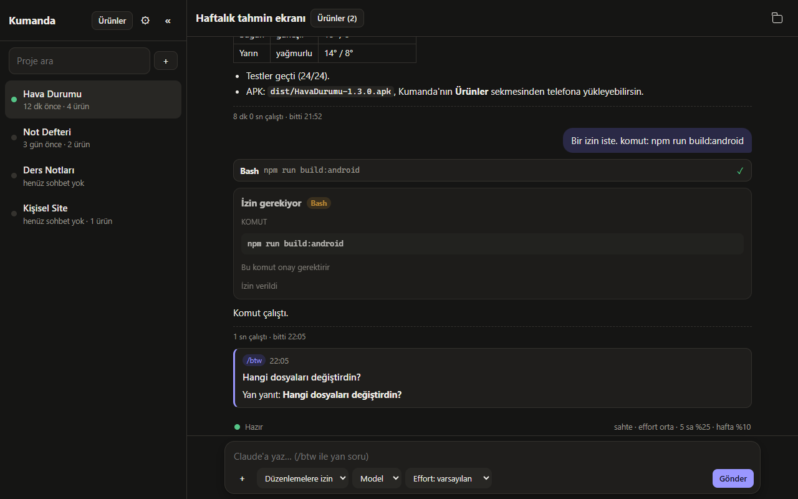
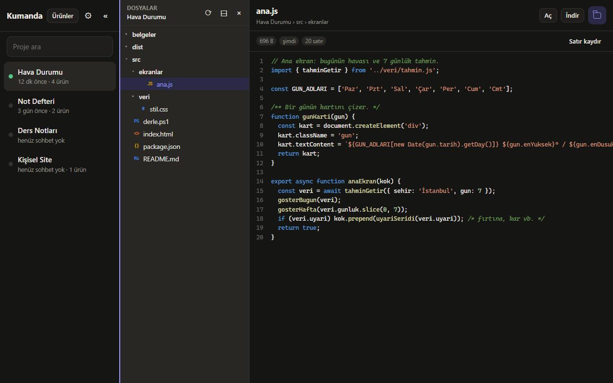

# Kumanda

Bilgisayarındaki **Claude Code**'u telefondan ya da başka bir bilgisayardan kullan; bütün projelerinin ürettiği **HTML, APK, EXE,
ZIP, video ve belgeleri** tek yerden aç ya da indir.

Bilgisayarın açık olduğu sürece, istediğin cihazdan bir proje seçersin, Claude'a yazarsın, yanıtını canlı okursun ve izin isterse
tek dokunuşla verirsin. Claude senin bilgisayarında, senin dosyalarında, senin Claude Code ayarlarınla çalışır; Kumanda yalnızca
kumandadır.

<p align="center">
  
  
  
  
  
</p>
<p align="center"></p>
<p align="center"></p>

<sub>Görüntüler tanıtım verisiyle üretildi (`araclar/ekran-goruntuleri.mjs`); gerçek bir projeye ait değildir.</sub>

> Bağımsız bir kişisel projedir. Anthropic ile bağlantısı yoktur, onun tarafından geliştirilmemiş ya da onaylanmamıştır.

## Neler yapabilirsin?

- **Bütün projelerin tek listede.** Projeler klasöründeki her klasör ve Claude Code'un daha önce çalıştığı her klasör, son etkinliğe
  göre sıralı. Bir sohbet çalışıyorsa yanında yeşil nokta yanar.
- **Yeni sohbet ya da kaldığın yerden devam.** Terminalde başlattığın oturumlar da listede; telefondan açıp sürdürebilirsin.
- **Canlı yanıt.** Yanıt yazıldıkça akar; Claude'un çalıştırdığı her komut ve düzenlediği her dosya ayrı satırda görünür.
  Tablolar, kod blokları ve listeler biçimli gösterilir.
- **İzinler telefonunda.** Claude bir komut çalıştırmak isterse kart çıkar: *İzin ver*, *Hep izin ver* ya da *Reddet*. Claude soru
  sorarsa seçenekleri görürsün; plan modunda planı onaylarsın.
- **Mod, model ve effort.** Her sohbette izin modunu (sor, düzenlemelere izin ver, plan…), modeli ve düşünme derinliğini seçersin;
  sohbet sürerken de değişir.
- **Yan sorular (`/btw`).** `/btw <sorun>` yazarsan Claude sohbetin kopyasında, işini bölmeden ve araç kullanmadan yanıtlar;
  soru ve yanıt sohbetin içinde saklanır. Terminalde sorduğun `/btw`'lerin soruları da görünür (Claude Code yanıtlarını
  kaydetmediği için onların yanıtı yoktur).
- **Resim gönder.** Ekran görüntüsünü ya da fotoğrafı isteme ekle; telefonda küçültülüp gönderilir.
- **Ürünler, onları üreten sohbete göre.** Her projenin Ürünler sekmesinde dosyalar, onları son değiştiren sohbetin başlığı altında
  durur; üstteki **Ürünler** düğmesi bütün projeleri aynı düzende, proje → sohbet diye gösterir. Web sayfası, video ve PDF
  tarayıcıda açılır; APK telefona yüklenir; EXE ve ZIP iner. Cihazına uymayanlar etiketlenir, eski sürümler ve kopyalar
  "Diğer dosyalar" altına iner. **Gizle** dediğin dosya silinmez: aynı sohbetin altındaki "Gizlediklerin" kutusuna geçer,
  **Göster** ile geri gelir; **Gizlenenlerin hepsini göster** hepsini birden geri alır.
- **Proje dosyaları, VS Code'daki gibi.** Klasör düğmesi (`Ctrl+Shift+E`) projeyi ağaç olarak açar; dosyalar satır numaralı ve
  renklendirilmiş görünür, Markdown önizlemeli, resimler doğrudan. Yalnızca görüntüleme; nokta ile başlayan dosyalar (`.env`…)
  gösterilmez.
- **Esnek düzen.** Bilgisayarda proje listesi ve dosyalar paneli kenarından sürüklenerek genişler, daralır, kapanır (`Ctrl+B`);
  telefonda proje listesi sağa kaydırınca soldan açılır, sola kaydırınca kapanır.
- **Bildirim.** Sayfa kapalıyken Claude işini bitirince ya da izin beklerken telefonuna bildirim gelir (cihaz başına açılır).
- **Koptuğunda iş durmaz.** Telefonun uykuya geçse de Claude çalışmaya devam eder; geri döndüğünde kaldığı yerden görürsün.
- **Açık ve koyu tema, telefona uygun düzen, ana ekrana eklenebilir (PWA).**

## Gerekenler

- Windows 10 ya da 11 (kurulum betikleri PowerShell'dir; sunucu Node.js olduğu için başka sistemlerde elle çalıştırılabilir)
- [Node.js](https://nodejs.org) 22 ya da üstü
- Kurulu ve giriş yapılmış [Claude Code](https://docs.claude.com/en/docs/claude-code) (`claude` komutu çalışıyor olmalı)
- Uzaktan erişim için ücretsiz bir [Tailscale](https://tailscale.com) hesabı (yalnızca bu bilgisayardan kullanacaksan gerekmez)

Başka bağımlılık yoktur: `npm install` bile gerekmez.

## Kurulum

```powershell
git clone https://github.com/Soft-Coder-183/kumanda.git
cd kumanda
powershell -ExecutionPolicy Bypass -File .\kur.ps1
```

`kur.ps1` Kumanda'yı arka planda başlatır, her oturum açılışında kendiliğinden başlaması için kısayol kurar ve tarayıcıda
**http://127.0.0.1:7777** adresini açar. İlk açılışta şifreni belirlersin (en az 10 karakter). Şifre yalnızca bu bilgisayardan
belirlenebilir.

Projelerin varsayılan olarak Kumanda klasörünün yanındaki klasörlerde aranır. Başka bir kök klasör için
`%LOCALAPPDATA%\Kumanda\ayar.json` dosyasındaki `kokler` listesini düzenle; tek bir klasörü de Ayarlar'dan ekleyebilirsin.

### Telefondan erişim

```powershell
powershell -ExecutionPolicy Bypass -File .\uzak-kur.ps1
```

Betik Tailscale'i kurar (yoksa), giriş yapmanı ister ve telefonda açacağın `https://<bilgisayar>.<ağın>.ts.net` adresini yazar.
Telefona da Tailscale uygulamasını kurup aynı hesapla giriş yap. Adres kalıcıdır; ana ekrana ekleyebilirsin.

Varsayılan olarak Kumanda **yalnızca senin Tailscale ağındaki cihazlara** açılır, internete açılmaz.
`.\uzak-kur.ps1 -Herkese` internete açar (Tailscale Funnel); o zaman tek koruma şifren ve giriş sınırıdır, önerilmez.

## Açma, kapatma, kaldırma

| Ne | Komut |
|---|---|
| Çalışıyor mu? | `node sunucu.mjs --durum` |
| Durdur | `node sunucu.mjs --durdur` |
| Yeniden başlat / güncelledikten sonra | `.\kur.ps1` |
| Uzaktan erişimi kapat (bilgisayarda kullanım sürer) | `.\uzak-kur.ps1 -Kapat` |
| Otomatik başlatmayı kaldır ve durdur | `.\kur.ps1 -Kaldir` |
| Şifreyi unuttum | `node sunucu.mjs --sifre-sifirla` (bütün cihazları çıkarır; yeni şifre bu bilgisayardan) |

Kumanda bir pencereye bağlı değildir: terminali kapatsan da çalışır. Bilgisayar uykuya geçince ya da kapanınca erişilemez.
Tamamen silmek için `.\kur.ps1 -Kaldir` çalıştırıp klasörü ve `%LOCALAPPDATA%\Kumanda` klasörünü sil.

Güncelleme: `git pull`, sonra `.\kur.ps1`.

## Güvenlik

Kumanda'ya giren kişi, Claude aracılığıyla bilgisayarında komut çalıştırabilir. Bu yüzden:

- Sunucu yalnızca `127.0.0.1`'i (bu bilgisayarın kendisini) dinler; ağdan doğrudan ulaşılamaz. Dışarıdan tek yol Tailscale'in
  şifreli tünelidir.
- İlk şifre yalnızca bu bilgisayardan konabilir; tünelden gelen biri sistemi sahiplenemez.
- Şifre scrypt ile özetlenir; açık hâli hiçbir yerde saklanmaz. 15 dakikada 5 hatalı denemeden sonra giriş kilitlenir.
- Cihaz oturumları `HttpOnly` çerezle tutulur ve Ayarlar'dan tek tek kapatılabilir.
- Ürün dosyaları ayrı bir kökenden (ayrı port) sunulur: bir ürün HTML'inin içindeki betik Kumanda'nın API'sini kullanamaz.
  Dosya gezgini de dosyaları Kumanda'nın içinde yalnızca düz metin olarak gösterir; hiçbir dosya orada sayfa ya da betik olarak
  çalışmaz.
- Ayarlar, şifre özeti ve oturumlar proje klasöründe değil `%LOCALAPPDATA%\Kumanda\` altında durur; depoya girmez.
- Claude'un izin kuralları senin Claude Code ayarlarındır; Kumanda bunları gevşetmez. "Hep izin ver" yalnızca o projenin
  `.claude/settings.local.json` dosyasına kural ekler.

Bir güvenlik sorunu bulursan lütfen herkese açık issue yerine GitHub'ın
[özel güvenlik bildirimi](https://github.com/Soft-Coder-183/kumanda/security/advisories/new) ile bildir.

## Nasıl çalışır?

```
telefon ──https──> Tailscale ──> 127.0.0.1:7777 Kumanda ──stdin/stdout──> claude -p (proje klasöründe)
                             └─> 127.0.0.1:7778 ürün sunucusu ──> proje klasörlerindeki dosyalar
```

Her sohbet için Claude Code'un kendi akış kipi (`claude -p --input-format stream-json --output-format stream-json`) başlatılır;
izin istekleri bu kanal üzerinden telefona taşınır. Geçmiş sohbetler Claude Code'un kendi kayıtlarından okunur, yani terminaldeki
oturumlarla aynı şeydir. Bir ürünün hangi sohbete ait olduğu, dosyanın değiştirilme zamanı ile sohbetin etkinlik zamanlarından
çıkarılır.

Ayrıntılı mimari, güvenlik modeli ve Claude Code protokolü notları: [`PROJE_DEVIR.md`](PROJE_DEVIR.md).

## Geliştirme

```powershell
node sunucu.mjs   # ön planda çalıştır
npm test          # sahte Claude ile uçtan uca testler (kota harcamaz)
.\derle.ps1       # denetim + test + yeniden başlat
```

Kod Türkçe adlandırılmıştır, dış bağımlılık yoktur. README görüntüleri: `npm i --no-save playwright-core`, sonra
`node araclar/ekran-goruntuleri.mjs` (kurulu Chrome kullanır). Sürüm notları [`notlar/`](notlar) klasöründe.

## Claude Code Remote Control ile farkı

Claude Code'un yerleşik `claude --remote-control` özelliği de bir oturumu claude.ai/code'dan ya da Claude uygulamasından
sürdürmeni sağlar. Kumanda'nın farkı: oturumu önceden bilgisayarda başlatman gerekmez (projeyi telefondan seçip yeni sohbet
açarsın), projelerin ürünlerini listeler ve açar, Anthropic'in sunucuları üzerinden değil kendi Tailscale ağın üzerinden çalışır.

## Lisans

[MIT](LICENSE)
