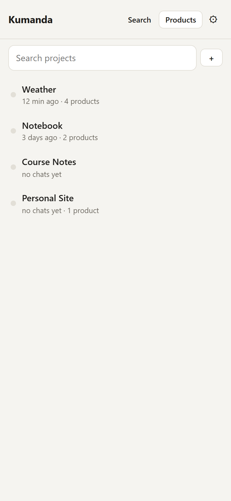
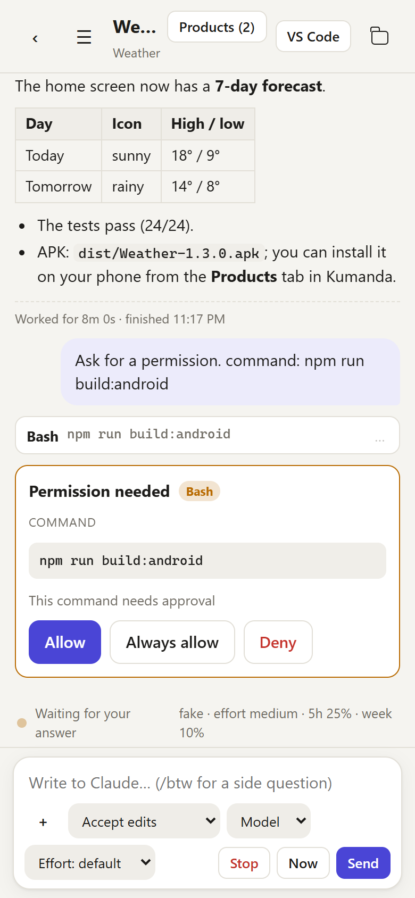
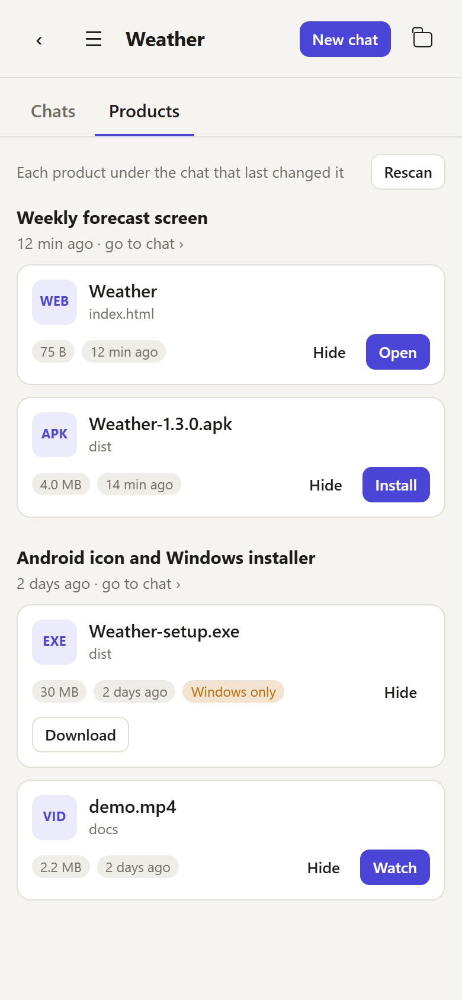
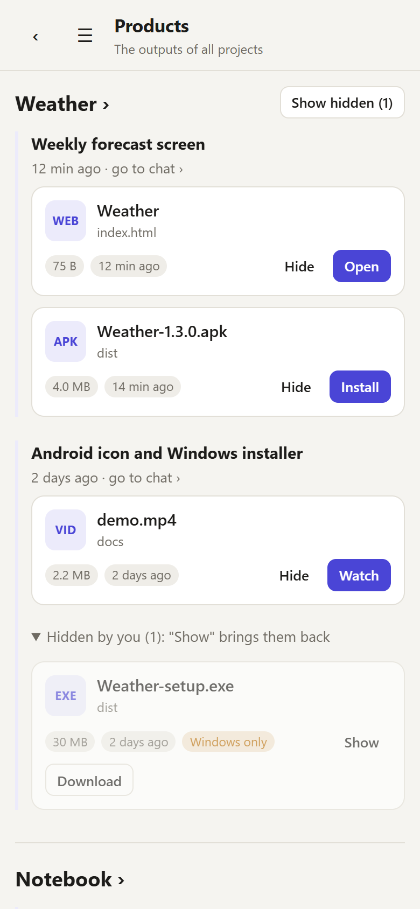
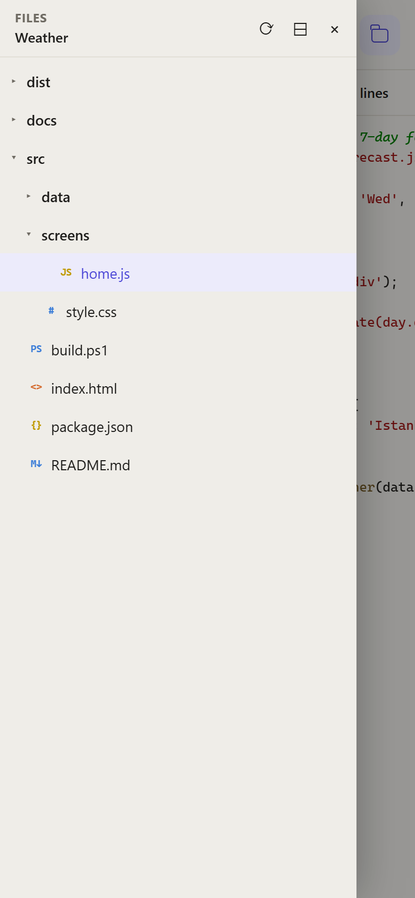
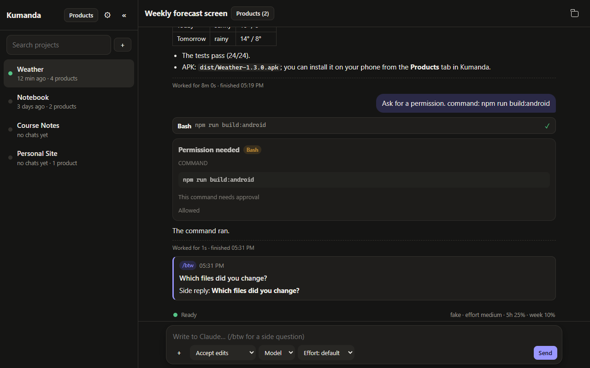
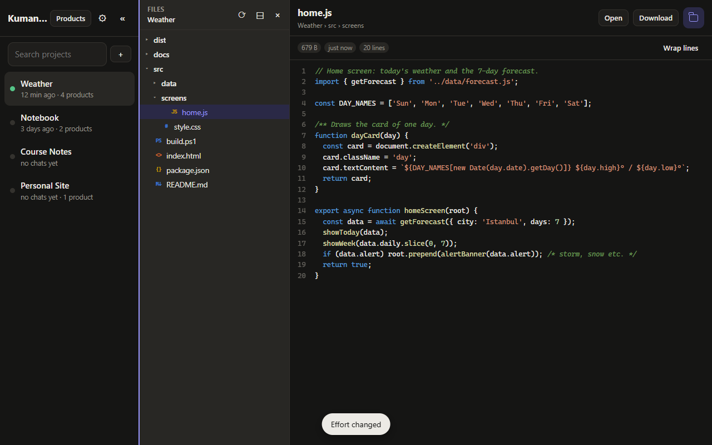

# Kumanda

Use the **Claude Code** on your computer from your phone or another computer; open or download the **HTML, APK, EXE, ZIP,
video and document** outputs of all your projects from one place.

As long as your computer is on, you pick a project from any device, write to Claude, read the reply live and grant a permission
with one tap. Claude runs on your computer, in your files, with your Claude Code settings; Kumanda is only the remote control.

<p align="center">
  
  
  
  
  
</p>
<p align="center"></p>
<p align="center"></p>

<sub>The screenshots are made with demo data (`tools/screenshots.mjs`); they do not belong to a real project.</sub>

> An independent personal project. It is not affiliated with Anthropic and is not developed or endorsed by Anthropic.

## What can you do?

- **All your projects in one list.** Every folder in your projects folder and every folder Claude Code has worked in, sorted by
  last activity. A green dot shows a running chat. Tapping a project opens its latest chat; **＋** creates a new project folder.
- **Start a new chat or continue where you left off.** Sessions you started in the terminal are in the list too; open and continue
  them from the phone.
- **How long it worked, when it finished.** The working time and finish time after every turn; the model, the effort and your
  subscription usage (5-hour and weekly, the last known value) in the status bar.
- **Live replies.** The reply streams as it is written; every command Claude runs and every file it edits shows on its own row,
  and runs of consecutive steps fold into one row you can open. Tables, code blocks and lists are formatted.
- **Permissions on your phone.** When Claude wants to run a command a card shows up: *Allow*, *Always allow* or *Deny*. When Claude
  asks a question you see the options; in plan mode you approve the plan.
- **Mode, model and effort.** In every chat you pick the permission mode (ask, accept edits, plan…), the model and the thinking
  depth; they change while the chat runs too. With "default" selected the real value from your Claude Code settings is shown; the
  status bar shows which effort the last request really used. After picking from a menu, Enter sends your prompt.
- **Queue it or send it now.** While Claude works Enter queues the prompt; `Ctrl+Enter` (or "Now") interrupts the running work and
  sends right away. Your unsent prompt is kept per chat; switching chats does not lose it.
- **Side questions (`/btw`).** Write `/btw <question>` and Claude answers in a copy of the chat that knows the whole conversation so
  far, without interrupting its work and without using tools; the question and answer are kept in the chat. The questions of `/btw`s you asked in the terminal show up too
  (they have no answer, because Claude Code does not save those answers).
- **Send images.** Attach a screenshot or a photo to the prompt; on the phone it is shrunk before sending.
- **Products, by the chat that made them.** In each project's Products tab the files sit under the title of the chat that last
  changed them; in a chat, the **Products** tab next to the title opens only that chat's products (you can look while writing);
  the **Products** button at the top shows all projects the same way, project → chat. Web pages, videos and PDFs open in the
  browser; an APK installs on the phone; EXE and ZIP download. Ones that do not fit your device are labelled; old versions and
  copies of the same product are not listed, helper files go under "Other files". A file you **Hide** is not deleted: it moves to
  the "Hidden by you" box under the same chat and comes back with **Show**; **Show all hidden** brings them all back.
- **Move around easily.** In a chat, **‹ Chats** (top left) goes to the project's other chats; from a file, **‹ Back to chat**
  takes you back to the chat you were writing in.
- **Continue on the computer in VS Code.** The VS Code button in a chat opens the project in VS Code on the computer, with the same
  chat in the Claude Code panel (the chat must not be working at that moment; Kumanda hands it over).
- **Project files, like in VS Code.** The folder button (`Ctrl+Shift+E`) opens the project as a tree; files show with line numbers
  and syntax highlighting, Markdown with a preview, images directly. View only; files starting with a dot (`.env`…) are not shown.
- **A flexible layout.** On the computer the project list and the files panel grow, shrink and close by dragging their edge
  (`Ctrl+B`); on the phone the project list opens from the left when you swipe right and closes when you swipe left.
- **Notifications.** When Claude finishes or waits for permission while the page is closed, your phone gets a notification
  (turned on per device).
- **The work does not stop when you disconnect.** Even if your phone goes to sleep Claude keeps working; when you come back you see
  it from where you left off.
- **See what is running.** The "Now" list at the top of the sidebar shows every chat that is working, waiting for you, or
  finished while you were away, across all projects.
- **Find anything.** `Ctrl+K` (or **Search** in the sidebar) finds projects, chats in every project and actions; in a project's
  Chats tab you can filter chats and search inside the messages. Chats can be pinned, renamed (the name shows in the terminal
  too) and archived.
- **Review the changes.** A project's **Changes** tab shows the git branch, the changed files with their diffs and the recent
  commits (read only).
- **Send later.** **Later** in the composer sends the prompt at a time you pick, or when the usage limit resets; a "You've hit
  your limit" reply gets a **Continue when the limit resets** button.
- **Saved prompts.** **Saved** inserts prompts you use often ("Continue.", "Run the tests…"); edit the list in Settings.
- **Drafts follow you.** An unsent prompt is saved on the computer too: start it on the phone, finish it on the computer. Pasted
  screenshots stay in the draft on that device.
- **Small comforts.** Copy buttons on replies and code blocks, **Edit again** on your prompts, ↑/↓ for earlier prompts, `Esc` to
  stop, a **Latest** button when new messages arrive while you read above, Claude's task list above the composer, the context
  size in the status bar, export a chat as Markdown, "Ask in chat" from a file, a connection banner, `?` for all shortcuts.
- **Share to Claude.** On Android, share text or a link from any app to the installed Kumanda and pick the project.
- **Light and dark theme (or follow the system), text size, a phone-friendly layout, can be added to the home screen (PWA).**

## Requirements

- Windows 10 or 11 (the setup scripts are PowerShell; the server is Node.js, so it can be run by hand on other systems)
- [Node.js](https://nodejs.org) 22 or newer
- [Claude Code](https://docs.claude.com/en/docs/claude-code), installed and logged in (the `claude` command must work)
- A free [Tailscale](https://tailscale.com) account for remote access (not needed if you only use it on this computer)

There are no other dependencies: not even `npm install` is needed.

## Setup

```powershell
git clone https://github.com/Soft-Coder-183/kumanda.git
cd kumanda
powershell -ExecutionPolicy Bypass -File .\install.ps1
```

`install.ps1` starts Kumanda in the background, adds a shortcut so it starts by itself every time you log in, and opens
**http://127.0.0.1:7777** in the browser. On the first visit you set your password (at least 10 characters). The password can
only be set from this computer.

By default your projects are looked for in the folders next to the Kumanda folder. For another root folder edit the `roots` list
in `%LOCALAPPDATA%\Kumanda\config.json`; you can also add a single folder from Settings.

### Access from the phone

```powershell
powershell -ExecutionPolicy Bypass -File .\remote-setup.ps1
```

The script installs Tailscale (if missing), asks you to log in and prints the `https://<computer>.<your-network>.ts.net` address
to open on the phone. Install the Tailscale app on the phone too and log in with the same account. The address is permanent; you
can add it to the home screen.

By default Kumanda opens **only to the devices in your Tailscale network**, not to the internet.
`.\remote-setup.ps1 -Public` opens it to the internet (Tailscale Funnel); then your password and the login limit are the only
protection, which is not recommended.

## Starting, stopping, removing

| What | Command |
|---|---|
| Is it running? | `node server.mjs --status` |
| Stop | `node server.mjs --stop` |
| Restart / after an update | `.\install.ps1` |
| Turn remote access off (use on the computer goes on) | `.\remote-setup.ps1 -Off` |
| Remove the automatic start and stop | `.\install.ps1 -Uninstall` |
| I forgot the password | `node server.mjs --reset-password` (logs out every device; the new password is set from this computer) |

Kumanda is not tied to a window: it keeps running if you close the terminal. When the computer sleeps or shuts down it cannot be
reached. To remove it completely run `.\install.ps1 -Uninstall`, then delete the folder and the `%LOCALAPPDATA%\Kumanda` folder.

Updating: `git pull`, then `.\install.ps1`. (Updating from 1.x: the settings, password, devices and side questions are moved to
the new file names by themselves on the first start.)

## Security

Whoever gets into Kumanda can run commands on your computer through Claude. So:

- The server only listens on `127.0.0.1` (this computer itself); it cannot be reached directly from the network. The only way in
  from outside is Tailscale's encrypted tunnel.
- The first password can only be set from this computer; someone coming through the tunnel cannot claim the system.
- The password is hashed with scrypt; it is not stored in clear anywhere. After 5 wrong attempts in 15 minutes the login is locked.
- Device sessions are kept with an `HttpOnly` cookie and can be closed one by one from Settings.
- Product files are served from a separate origin (a separate port): a script inside a product's HTML cannot use Kumanda's API.
  The file explorer, too, only shows files as plain text inside Kumanda; no file runs there as a page or a script.
- The settings, the password hash and the sessions are not in the project folder but under `%LOCALAPPDATA%\Kumanda\`; they never go
  into the repository.
- Claude's permission rules are your Claude Code settings; Kumanda does not loosen them. "Always allow" only adds a rule to that
  project's `.claude/settings.local.json`.

If you find a security problem, please report it through GitHub's
[private security advisory](https://github.com/Soft-Coder-183/kumanda/security/advisories/new) instead of a public issue.

## How does it work?

```
phone ──https──> Tailscale ──> 127.0.0.1:7777 Kumanda ──stdin/stdout──> claude -p (in the project folder)
                           └─> 127.0.0.1:7778 product server ──> the files in the project folders
```

For every chat Claude Code's own streaming mode (`claude -p --input-format stream-json --output-format stream-json`) is started;
permission requests are carried to the phone over this channel. Past chats are read from Claude Code's own logs, so they are the
same thing as the sessions in the terminal. Which chat a product belongs to is worked out from the file's modification time and
the chat's activity times.

A `/btw` side question runs a separate, short-lived copy of the chat (`--resume <chat> --fork-session --no-session-persistence`)
with the same settings as the chat, so it reads the chat's prompt cache instead of paying for the whole conversation again; a hook
blocks every tool call in it. The chat itself, its transcript and its context do not change.

Detailed architecture, the security model and notes on the Claude Code protocol: [`HANDOVER.md`](HANDOVER.md).

## Development

```powershell
node server.mjs   # run in the foreground
npm test          # end-to-end tests with a fake Claude (spends no quota)
.\build.ps1       # check + test + restart
```

No external dependencies. README screenshots: `npm i --no-save playwright-core`, then `node tools/screenshots.mjs` (uses the
installed Chrome). Release notes are in the [`notes/`](notes) folder.

## How is it different from Claude Code Remote Control?

Claude Code's built-in `claude --remote-control` also lets you continue a session from claude.ai/code or the Claude app. What
Kumanda adds: you do not need to start the session on the computer first (you pick the project on the phone and open a new chat),
it lists and opens your projects' products, and it works over your own Tailscale network instead of Anthropic's servers.

## License

[MIT](LICENSE)
